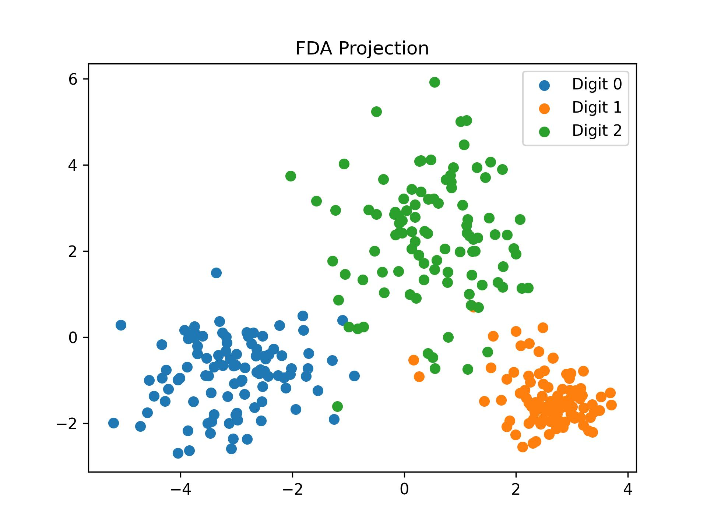
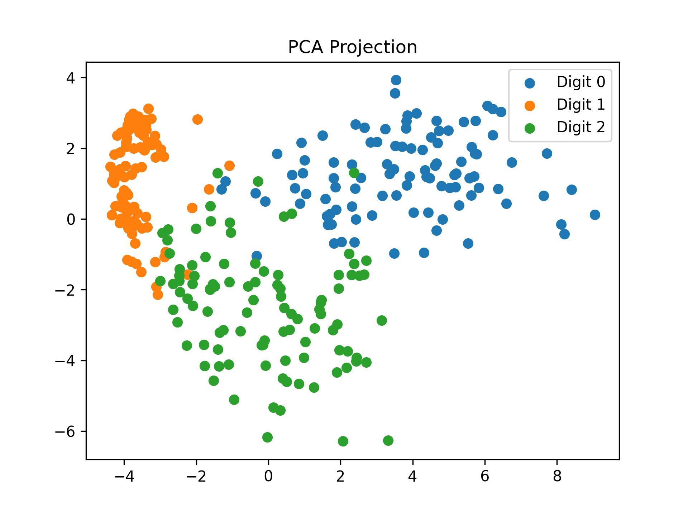
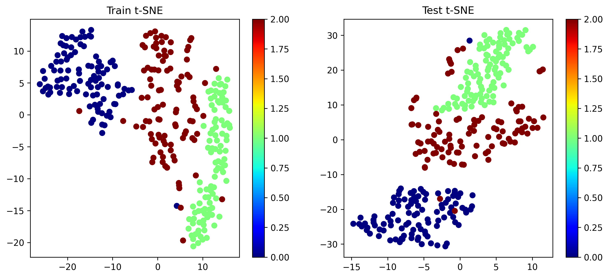
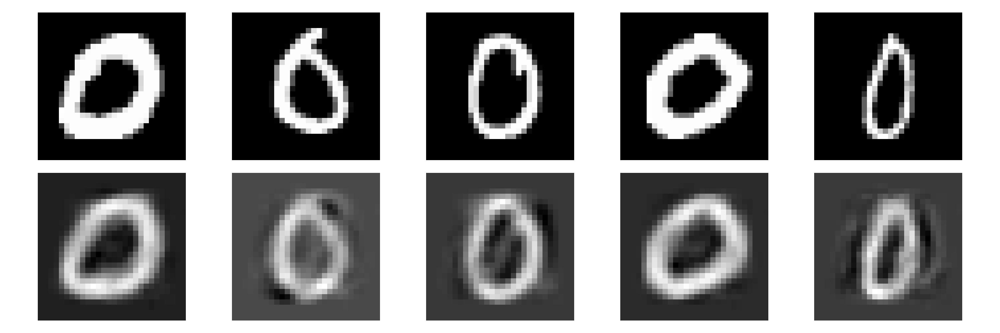
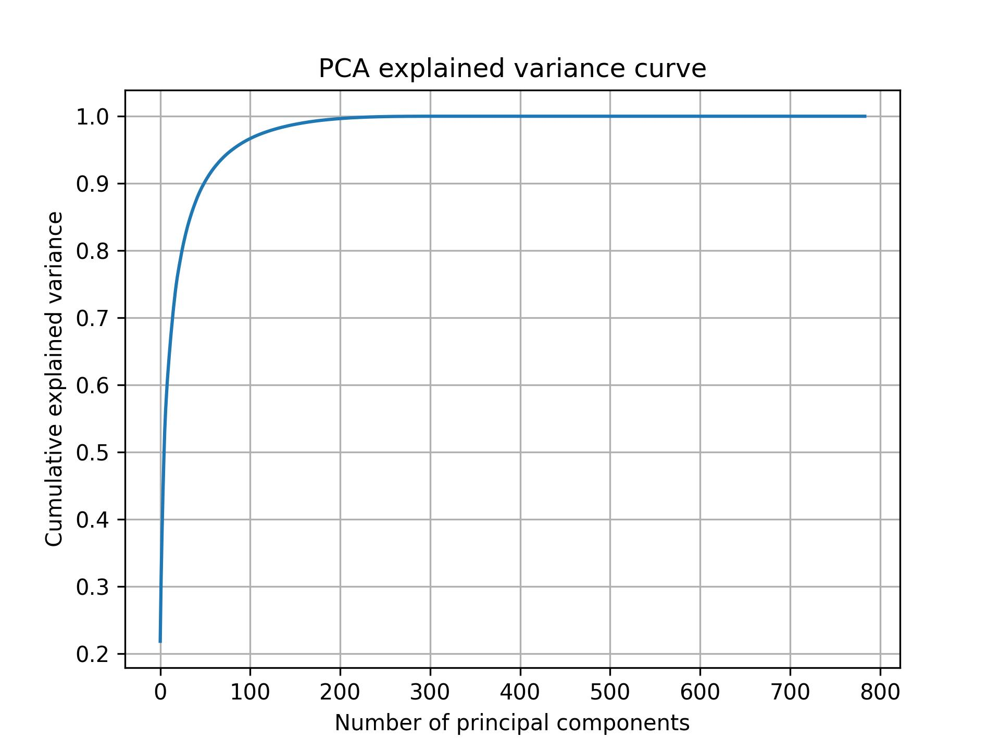

# Statistical Classifiers on MNIST

LDA, QDA, PCA and Fisher Discriminant Analysis written from scratch in NumPy, used to classify MNIST digits 0, 1 and 2. The only library model used is scikit-learn's t-SNE, for visualisation.

Done as part of the Statistical Machine Learning course at IIIT-Delhi (Jan–Apr 2026).

## What's in here

| File | What it does |
|---|---|
| `lda_qda_mle.py` | Estimates class means, covariances and priors with MLE, then classifies with LDA (pooled covariance) and QDA (per-class covariance) directly on the raw 784-D pixels. Also plots t-SNE of the train and test sets. |
| `pca_fda_classifiers.py` | PCA via eigendecomposition of the covariance matrix, reconstruction error, FDA projection to 2-D, and LDA/QDA trained on the reduced features. |

## Setup

- 3 classes (digits 0, 1, 2), 100 random samples per class for training and 100 per class for testing (300 + 300)
- Pixels scaled to [0, 1]
- Fixed seed (42), so runs are reproducible
- Small diagonal regularisation added to covariance matrices so they can be inverted

## Results (test accuracy)

| Features | LDA | QDA |
|---|---|---|
| Raw pixels (784-D) | 90.33% | **99%** |
| PCA, 75% variance (19 components) | 95% | 97% |
| PCA, 90% variance | 95% | 94.33% |
| FDA (2-D) | 95% | 95% |
| Top 2 PCs only | 92% | 93.67% |

Some observations:

- QDA beats LDA almost everywhere. The three digits have quite different shapes, so a separate covariance per class helps.
- 19 PCA components (out of 784) are enough to keep 97% accuracy.
- Going from 75% to 90% variance doesn't help QDA. With only 100 samples per class, more dimensions means noisier covariance estimates and QDA starts to overfit (100% train, 94.33% test).
- FDA squeezes everything into 2 dimensions and still gets 95%, because it uses the labels to pick directions that separate the classes. PCA doesn't use labels, which is why its 2-D projection overlaps more.

## Plots

**FDA vs PCA projection (2-D)**




**t-SNE of train and test sets**



**PCA reconstructions (top: original, bottom: 19 components)**



**Cumulative explained variance**



## How to run

```bash
pip install -r requirements.txt
# put the 4 MNIST idx files in data/ (see data/README.md)
python lda_qda_mle.py
python pca_fda_classifiers.py
```

Plots are saved to `results/`.
